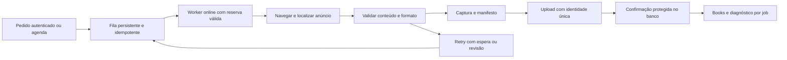

# Objetivo e plano de execução — captura Adsnap

Início: 14/10/2026. Publicação e conferência em produção autorizadas pelo responsável pelo projeto. A proposta parte da auditoria do commit `2f9fd474345e9a50a76c517e0a24b4984d81d12c`.

## Objetivo

Transformar a captura online de campanhas em um serviço confiável: cada pedido executado uma vez por ocorrência, evidências com formato e conteúdo verificáveis, recuperação segura após falhas e diagnóstico claro no site. O serviço deve funcionar sem o notebook ligado e sem serviços pagos obrigatórios. Métricas publicitárias e relatórios não fazem parte desta reconstrução.

## Critérios de resultado

- Logs só são acessíveis por sessão autorizada e não expõem credenciais.
- Pedidos concorrentes não criam processamento duplicado da mesma campanha; somente o dono atual pode confirmar ou recuperar uma tarefa.
- Agenda e tentativas usam uma fila, respeitam horário de Brasília, captura manual e espera de retry.
- Slot vazio ou dimensão incompatível não recebem aprovação automática; casos inconclusivos informam o motivo.
- Falhas de infraestrutura aparecem como falhas no run, no site e no CI.
- Um job possui identidade, página funcional, tentativas, etapas, resultado e referência ao artefato.
- Evidência observada, preview modificado e montagem são distinguíveis; metadados e hashes acompanham o resultado.
- Consumo de runner, banco e armazenamento possui limite; nenhuma expansão paga automática é necessária.

## Etapas e entregas

| Etapa | Entrega | Conferência para liberar |
|---|---|---|
| 1 — segurança e veracidade | Proteger/redigir logs; remover prefixo de token dos logs; resultado verdadeiro do ciclo; corrigir aceitação indevida de slot | Testes de acesso, redação, falha de infraestrutura e fixtures com browser |
| 2 — execução exclusiva | Enqueue transacional, claim consistente, posse condicionada a dono/tentativa, renovação e recuperação segura; bloquear fallback que ignora job futuro | PostgreSQL isolado, duas conexões, concorrência, tentativa antiga e interrupção |
| 3 — agenda e diagnóstico | Datas civis consistentes, recuperação respeitando política manual/quarentena; detalhe de job; contadores e ciclos coerentes | Regressões de datas/retry, navegação desktop/mobile, logs após falha |
| 4 — evidência e eficiência | Manifesto, política para raw/derivados, arquivo imutável, executor dedicado a captura, cache e consultas menores | Medição antes/depois, limites de quota, conferência visual e auditoria do artefato |

As etapas podem compartilhar um release quando as dependências exigirem, mas cada correção terá teste e revisão próprios. Primeiro serão publicadas mudanças compatíveis com o banco atual. Migrações aditivas serão testadas isoladamente antes de qualquer aplicação.

## Pipeline desejado

## Estratégia de publicação

1. Trabalhar em branch isolada, com arquivos divididos entre agentes para evitar conflitos.
2. Executar testes de regressão, TypeScript/build e testes de integração necessários à entrega.
3. Solicitar revisão técnica independente e conferência visual do fluxo alterado.
4. Publicar um commit rastreável no repositório que alimenta o serviço atual.
5. Conferir deploy, acesso anônimo bloqueado, sessão legítima funcional, página dos workers e comportamento das capturas.
6. Se houver regressão material, reverter o commit publicado e conferir a recuperação. Não reescrever histórico nem apagar dados para desfazer release.

## Verificação em produção

Começar por consultas e navegação. Uma captura de validação deve ser identificada como teste, com escopo pequeno e sem disparar emails ou relatórios. Não usar campanhas reais como teste de carga. Registrar SHA, data, verificações e resultado de cada deploy.

## Operação sem custos obrigatórios

A implementação aproveita a infraestrutura existente e usa ferramentas locais gratuitas para testes. Não precisa de API paga de IA no fluxo de captura. Limites de tempo, tentativas, uploads, retenção e consultas evitam crescimento silencioso de consumo. Os limites gratuitos das contas precisam ser medidos; este plano não promete capacidade ilimitada nem ganho percentual não medido.

Na primeira entrega, manter a imagem moldurada atual evita duplicar armazenamento. Registrar hashes do raw e do derivado e identificar o tipo de evidência. Hash não substitui a preservação do raw: a próxima etapa deve definir raw canônico e derivado gerado sob demanda dentro do orçamento, com retenção explícita.

## Estado inicial e registro

- Auditoria: 73 verificações de caracterização, incluindo seis cenários com Chromium real; isso reproduziu comportamentos e não aprovou o baseline.
- Etapas 1–3: implementadas neste branch, com regressão local aprovada; publicação e conferência cloud registradas separadamente.
- Etapa 4: parcial. Identidade única, hashes e classificação foram implementados; preservação física do raw, derivados sob demanda, retenção e medição de capacidade continuam pendentes. Auditoria de egress/SSRF e sandbox também fica para entrega específica.
- Agentes: segurança/logs; fila/posse; captura/agenda; coordenador para diagnóstico, integração, plano e publicação. Revisores independentes entram após implementação.
- Releases e evidências serão registrados em `docs/REGISTRO-DE-PUBLICACOES.md`.
- Primeira publicação online verificada: controle positivo salvou PNG com hash correspondente; controle negativo foi recusado e terminou em FAILED no Actions. O login teve regressão por AUTH_SECRET ausente/legado e foi restaurado por rollback parcial. A chave privada ainda depende de configuração na Vercel; a proteção das sessões não está encerrada. Ver o registro antes de avaliar o estado atual.
- O último parecer independente encontrou um bloqueador de CSP, corrigido e coberto por teste que passou. O agente atingiu o limite de uso antes de nova assinatura; a distinção entre parecer original e verificações do coordenador está em `docs/GATE-TECNICO-RELEASE.md`.
